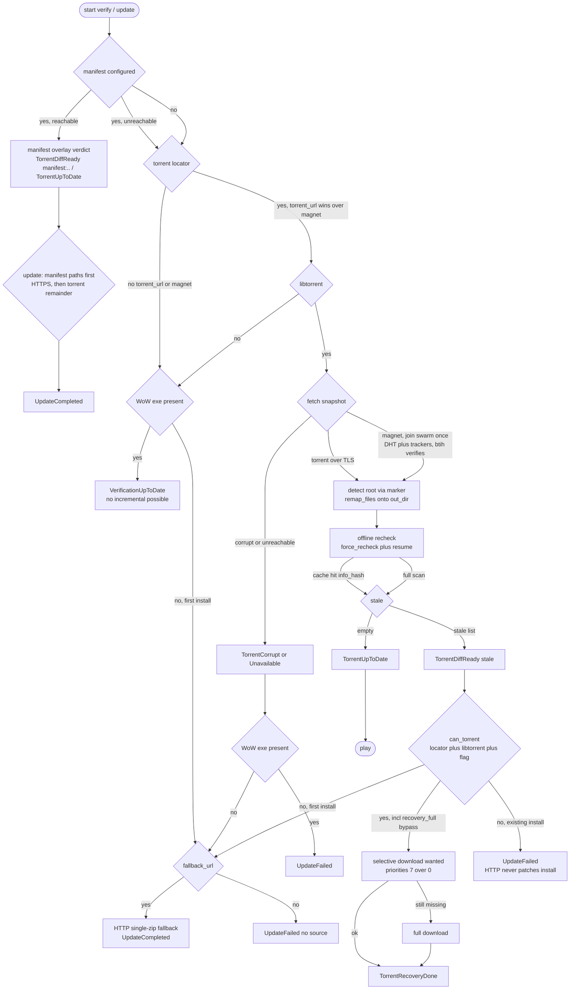

# Client Update Workflow

> Base-client incremental updates are **torrent-only** (piece hashes);
> an optional **manifest overlay** (server-owned files over the base
> client) downloads per-file over HTTPS from the manifest's own URLs;
> HTTP is otherwise a **single-zip fallback for first install only**.
> No per-file HTTP `traverse()`. Workers post typed dataclass events;
> the controller mutates state; Qt renders via a 50 ms bridge drain.

## 0. Flowchart



## 1. Components

| Piece | File | Role |
|---|---|---|
| `VerifyWorker` / `UpdateWorker` | `services/update/workflow.py` | Orchestrator facade: `VerifyWorker.run()` verifies; `UpdateWorker` splits into `run_initial()` (one-off full acquisition — BitTorrent full, then single-zip HTTP fallback) and `run_incremental(wanted)` (manifest HTTPS first, torrent selective second). `run()` keeps the legacy signature and dispatches by stage for API stability. |
| `ownership` / `stages_*` | `services/update/ownership.py`, `stages_initial/static/manifest/torrent.py` | Stage logic: ownership guardrail, initial acquisition, static/manifest/torrent incremental |
| `services/manifest.py` | `services/manifest.py` | server-agnostic manifest overlay: fetch/parse/route/bundled entries (`manifest:`-prefixed stale paths) |
| `DownloadSource` / `_download_source()` | `services/update_backend/sources.py` | Resolve `torrent_url` / `magnet` / `fallback_url` from `server.download` |
| `UpdateController` | `controllers/update.py` | Lifecycle owner; `_on_event` mutates `UpdateState`; `compute_readiness()` drives footer |
| `ControllerBridge` | `ui/bridge.py` | Drains `EventDispatcher` every 50 ms → Qt signals |
| Events | `state/events.py` | Typed dataclasses (`TorrentDiffReady`, `TorrentUpToDate`, `UpdateCompleted`, …) |

```
UI → UpdateController.start_verify()/start_update()
  → worker thread → services → EventDispatcher.post(event)
  → UpdateController._on_event → UpdateState
  → bridge (50 ms) → Qt signals → panels
```

Config: `server.download.torrent.{torrent_url, magnet, update?}` +
`server.download.manifest.{url, schema, routes}` (optional overlay) +
`server.download.http.fallback` + `server.download.content.type`
(`folder`/`zip`/`rar`). `.torrent` wins when both URL and magnet are set.
`has_exe` = configured client exe (`server.client_executable`, default `WoW.exe`, case-insensitive) or external-launcher exe present.
Manifest entries own a `manifest:`-prefixed stale namespace so the update
path stays uniform; the manifest's `sha256` is parsed/validated but not
yet enforced (existence-only staleness).

## 2. Source resolution

`_download_source()` → `DownloadSource(torrent_url, fallback_url, magnet)`:

- `torrent_locator = torrent_url or magnet`.
- `has_torrent() = bool(torrent_url or magnet)`.
- `torrent_update_allowed()`: explicit `torrent.update` wins; else inferred
  as `bool(torrent_url)` — **magnet-only defaults to first-time-only**
  (magnet content is immutable once published — info-hash addressed —
  so it cannot carry updates; only a refreshed `torrent_url` can),
  `torrent_url` defaults to updatable.

## 3. Verify (`VerifyWorker.run`)

1. Post `Verifying…` progress; seed `WTF/Config.wtf` + `realmlist.wtf` if
   `overwrite_config` or missing.
2. Ownership guard (`ownership.check_server_write`): when the manifest
   stage owns the verdict, collisions between server-owned paths and
   user `installed_files` are logged (server wins, never silent);
   downloads into `Interface/` / `dlls.txt` are refused.
3. Manifest overlay (`stages_manifest.split_manifest_paths`), when
   `server.download.manifest` is configured: fetch + parse the upstream
   manifest (HTTPS, 2 MiB cap, `__manifest_snapshot__` cache, offline
   serves cache); post `TorrentReachable`, then existence-compare listed
   paths against the client and post `TorrentUpToDate` /
   `TorrentDiffReady(manifest:…)` (sorted, `manifest:`-prefixed). A
   reachable manifest owns the verdict (the torrent base is a
   third-party client the manifest publisher does not version).
   Unreachable manifest → fall through to the torrent path below.
3. No `torrent_locator` or no libtorrent → `_handle_no_torrent()`:
   - existing install (`has_exe`) → `TorrentUnavailable` + `VerificationUpToDate`
     (nothing incremental to do; HTTP never patches an install);
   - first install → `TorrentUnavailable`; UPDATE offers the fallback zip if
     `fallback_url` is set.
3. Else `_torrent_verify(src)`:
   - Fetch `.torrent` over `secure_urlopen` (HTTPS-only, TLS ≥ 1.2,
     5 MiB cap), cache per-profile at
     `torrents/<info_hash>.torrent`.
   - Magnet: join the swarm **once** to fetch metadata (DHT + embedded
     trackers, throwaway save path, upload-mode when exposed). The `btih`
     authenticates the metadata.
   - Detect root from the unique marker (`WoW.exe`, or
     `server.torrent_root_marker`), `remap_files()` onto `out_dir`
     (double-prefix fix; no-op on test fakes).
   - **Offline session** (`listen_interfaces=""`, DHT/LSD/UPnP/NAT-PMP off),
     `force_recheck()` + `resume()`, stall-guarded wait. File stale iff any
     covering piece missing (`have_piece()` / `sum(status.pieces)`).
   - Cache verdict under `__torrent_validation__`
     (`info_hash`/`content_hash` + `out_dir` + `stale`). Same identity →
     skip re-scan, re-post cached verdict. Changed `info_hash` → discard
     verdict + old resume data.
   - Post `TorrentReachable` then `TorrentUpToDate` / `TorrentDiffReady(stale)`
     or `TorrentCorrupt/Unavailable/Stalled/SessionError/DiskError/VerifyFailed`.
4. `compute_readiness()` stays `disabled / "Verifying…"` until a verdict
   (`torrent_stale/reachable/error`) exists.

## 4. Update (`UpdateWorker.run_initial` / `run_incremental`)

`UpdateController.start_client_download()` → `run_initial()` (initial
stage: full base acquisition, torrent-full then HTTP fallback, no
stale-set logic). `UpdateController.start_update()` → `run_incremental(wanted)`
(incremental stage: patch a playable client).

Incremental inputs: `wanted` (stale set from verify, `manifest:`-prefixed
entries first).

- `manifest:` paths download first via `_manifest_overlay_download()`:
  HTTPS from each entry's own `download_url` (`download_file` resume +
  retry, per-file progress), `remove_wdb`, record version under
  `__manifest_installed__`. Failure posts `UpdateFailed`. Manifest-only
  stale set → `UpdateCompleted` without touching torrent.
- Remaining (non-`manifest:`) paths flow to the torrent stage below
  (`_torrent_stage.torrent_allowed` policy — frozen/magnet-only leaves
  torrent-owned paths unpatched):
- `can_torrent = locator and libtorrent and torrent_allowed`:
  - ✅ → `_recovery_download(wanted)`: **online session**,
    per-file priorities `7` = wanted, `0` = rest (selective).
    Selective still missing files afterwards → escalate
    to full. No exe after → `UpdateFailed`. Else `remove_wdb`,
    seed configs if missing, cache `stale:[]`, post `TorrentRecoveryDone`.
  - ✅ but throws → `UpdateFailed` (no fallback: HTTP never patches
    an install).
  - ❌ → `UpdateFailed` — manifest-uncovered paths on a frozen /
    torrent-less source stay unpatched; **HTTP never patches an install**.

`run_initial()` (first acquisition, no playable client yet) is the only
path that touches the HTTP fallback: torrent-full first, single-zip
fallback second, else `UpdateFailed("No download source")`.

## 5. Scenario matrix

| torrent_url | magnet (+`update?`) | libtorrent | Install | Verify | Update |
|---|---|---|---|---|---|
| – | – | – | existing | up-to-date (no incremental) | n/a |
| – | – | – | first | unavailable | HTTP zip if configured, else fail |
| ✅/– | –/✅ | ❌ | any | same as no-torrent rows | HTTP zip on first install only |
| ✅ | – | ✅ | any | offline verify → up-to-date / diff | selective / full via torrent |
| – | ✅ (unset/`false`) | ✅ | any | verify (one swarm fetch for metadata) | incremental **refused**; full first-install only |
| – | ✅ (`true`) | ✅ | any | verify | selective / full via torrent |
| ✅ | ✅ | ✅ | any | `.torrent` used, magnet ignored | same |
| corrupt/unreachable | – | ✅ | any | `Corrupt/Unavailable/…` | first install + fallback → HTTP; else fail |

## 6. The `torrent.update` flag

- Magnet-only needs `update:true` to enable incremental at all (default
  `false` = first-install-only, keeping swarm/DHT cost opt-in).
- `torrent_url` + `update:false` freezes incremental pushes while keeping
  first-install (full recovery bypasses the flag) — a server-side kill-switch
  with no client release.
- Note: verify ignores the flag (still reports diff), but neither the
  footer nor the tab can reach the dead end: readiness falls through to
  PLAY on an existing install, and the UPDATE tab hides once a playable
  client exists (`update_tab_enabled`). First acquisition still uses the
  tab + footer DOWNLOAD (full recovery bypasses the flag).
- A failed torrent download posts `Torrent*` + `UpdateFailed`; the
  controller lands one terminal — the `UpdateFailed` echo is ignored
  once `_op` cleared, keeping the specific torrent error.
  enforces it. So `update:false` surfaces as UPDATE → `UpdateFailed` on
  existing installs.

## 7. Readiness & launch (after update)

`compute_readiness()`: `busy` → `play` (up-to-date) / `update` (stale) /
`disabled` (no source + can't launch) / `terminate` (game running → red
TERMINATE → `umu.kill_game()` SIGTERM → SIGKILL after 2 s). One game process
at a time; `_watch_game` drains child output (`[umu]`/`[game]`, 800-line cap)
into the session log, then posts `GameExited`.

## 8. libtorrent pitfalls (see `bittorrent-notes.md` P1–P10)

P1 remap absolute paths (`remap_files`) — double-prefix fix · P2
`resume()` after `force_recheck()` · P3 `sum(status.pieces)`, never
`count()`/`verified_pieces` · P4 relative-path mangling · P5 info-hash
stable, no resume persistence · P6 offline session flags · P7 stall guard
(60 s / 180 s discovery) · P8 piece-vs-file granularity (advisory) ·
P9 URL ≠ identity · P10 magnet needs networking once, `btih` authenticates.
